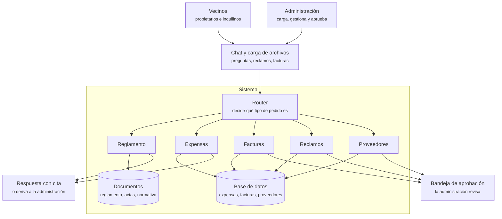

# IAA – Asistente para consorcios

TP grupal de Inteligencia Artificial Agéntica (Maestría en Data Mining, UBA) – Grupo 6.

Asistente para la administración de consorcios: responde consultas sobre reglamento y expensas citando la fuente, asiste la carga de facturas, registra reclamos y ayuda a gestionar proveedores, con revisión humana en las acciones importantes.

## Cómo funciona



- **Consultas** (reglamento, expensas): el sistema busca en los documentos o en las tablas y responde citando la fuente. Si no puede verificar la respuesta, deriva a la administración.
- **Acciones** (guardar una factura, registrar un reclamo, contactar a un proveedor): el sistema las propone y la administración las aprueba, edita o rechaza antes de que se ejecuten.

El diagrama es el diseño completo. Hoy funcionan por la web el router, reglamento, expensas, listado de documentos, derivación a una persona y reclamos con aprobación. Facturas y proveedores no entran en esta etapa, y Telegram queda congelado hasta terminar la web: sigue contestando como antes, sin pasar por el router. Lo único nuevo que puede ver es el aviso de tope alcanzado al cargar un PDF.

## Próximos pasos

**1. Datos**
- [x] OCR del reglamento de copropiedad y las 4 actas (76 páginas escaneadas) → `consorcio ingestar` (26/10); falta revisión a mano
- [x] Extraer el texto del reglamento de cocheras y las convocatorias (26/10); falta la normativa
- [x] Pasar las 8 liquidaciones a una tabla (período, rubro, gasto, unidad) → `consorcio expensas` (26/10)
- [ ] Extraer los datos de las facturas y compararlos contra el listado de gastos de agosto
- [ ] Cargar la tabla de unidades (`make alta-unidades`; el prorrateo de las liquidaciones ya da UF, piso-depto y porcentual)
- [x] Escribir las preguntas de prueba con su respuesta correcta, separadas en dev y test → `datos/evaluacion/preguntas.csv` (26/10, 26 preguntas: cocheras, actas, convocatorias, liquidación, reglamento de copropiedad y 2 trampa; ampliar)

**2. Buscador sobre documentos**
- [x] Índice: las secciones que deja la ingesta en Postgres, búsqueda de texto completo en español (26/10)
- [x] Comparar contra una búsqueda por palabras clave → `consorcio evaluar-consultas` (26/10)
- [x] Canal de Telegram (`make bot`): PDF → ingesta, texto → `preguntar`, `/expensas` → SQL, lista blanca de chats
- [x] Una base por consorcio y por chat de Telegram (`consorcio_id` en documentos y consultas; `make consorcios`, `make asignar`); falta la UI de administración de consorcios
- [x] Crudos en un bucket S3 y control de duplicados por hash y por período (01/11)
- [x] Migraciones con Alembic y usuarios con membresía por consorcio (01/11); login con mail y contraseña (09/11)
- [ ] WhatsApp: queda para después (la API de Meta pide número de negocio, verificación y webhook público; ver bitácora 26/10)
- [ ] Probar embeddings (pgvector) o pesos por título: en test el baseline de palabras clave le ganó a tsvector (0,917 vs 0,583 de recall@3; ver `docs/evaluaciones/2026-10-26-consultas-y-expensas.md` §3)

**3. Respuestas con cita**
- [x] Responder con las secciones encontradas, citando la fuente → `consorcio preguntar` (26/10)
- [x] Verificar que la cita exista textualmente y derivar cuando no se puede responder (26/10)

**4. Herramientas sobre las tablas**
- [x] Consultar expensas por SQL (26/10)
- [x] Registrar reclamos como solicitudes pendientes de aprobación (01/11)
- [ ] Buscar proveedores: fuera de esta etapa
- [x] Router que decide qué herramienta usar → `agente/` (01/11); hoy atiende a la web, Telegram sigue congelado
- [x] Set de 36 mensajes para evaluar el router (`datos/evaluacion/mensajes_agente.csv`) y comando que lo compara contra un router por palabras clave → `consorcio evaluar-agente` (23/11); falta la corrida con un modelo real

**5. Carga de facturas y bandeja de aprobación**
- [ ] Leer una factura y extraer sus datos: fuera de esta etapa
- [x] Bandeja donde la administración aprueba, edita o rechaza → `/bandeja` (01/11)

**6. Web y seguimiento**
- [x] Web de pruebas: chat, documentos, solicitudes y bandeja (01/11)
- [x] CRM para el equipo de plataforma → `/crm` (01/11)
- [x] Tope de gasto mensual en la aplicación (01/11); falta contrastarlo con una factura real
- [x] Login real con mail, contraseña e invitaciones, sobre el código de Lucas → `auth/` (09/11); falta la pantalla para invitar y cargar unidades

**Cierre**
- [ ] Correr la evaluación sobre el set de test
- [ ] Medir costos y tiempos
- [ ] Completar el informe y armar la presentación

## Qué hay en el repo

**Para entender la prueba de concepto tal como está hoy** (diagramas del agente, qué pasa con cada petición, números medidos y límites): [`docs/poc.md`](docs/poc.md).

- `docs/informe.md`: el informe del TP, organizado según lo que pide la consigna.
- `docs/bitacora.md`: notas de cómo fue el desarrollo.
- `docs/fuentes.md`: qué datos usa el sistema y de dónde salen.
- `docs/consigna.md` y `docs/propuesta/`: consigna, propuesta presentada, devolución de la cátedra, entrevista e ideas de módulos.
- `datos/`: normativa, documentos, expensas, facturas y comunicados reales del consorcio, más proveedores y preguntas de prueba.
- `src/`: el código (ver `src/LEEME.md`).
- `skills/`: instrucciones versionadas que recibe el modelo (`ingesta`: transcribir, clasificar, estructurar, liquidación; `consulta`: responder con cita; `agente`: router).
- `tests/`: pruebas; corren con el proveedor `fake` sin gastar tokens.
- `docs/evaluaciones/`: resultados de cada evaluación corrida (OCR, extracción), con fecha.
- `docs/practicas/`: consignas de las prácticas de la materia en las que se basa el diseño (LangGraph, HIL, MLflow).

## Cómo correrlo

Todo corre en Docker (app con Python 3.12 + Tesseract, Postgres, SeaweedFS y MLflow).

```bash
cp .env.example .env        # completar LLM_PROVIDER y la clave del proveedor; con "fake" corre sin clave
docker compose build
docker compose up -d
make test                   # tests sin modelo real, en la base consorcio_test y un bucket de prueba

# Tool 1: ingestar un PDF (clasifica calidad → extrae → estructura → guarda)
make ingestar PDF="datos/documentos/REGLAMENTO COCHERAS MERCEDES_12-05-2026_18_59_13 (1).pdf"
make ingestar PDF="datos/documentos/ACTA_MERCEDES_25-7-2024.pdf" METODO=vision   # forzar método

# Procesar solo algunas páginas y elegir proveedor/modelo para esa corrida
docker compose exec app consorcio ingestar "datos/documentos/REGLAMENTO DE COPROPIEDAD_10-04-2025_16_24_47 (1).pdf"     --paginas 1-5 --proveedor anthropic --modelo claude-haiku-5-5

# Volver a estructurar sin pagar de nuevo la transcripción (reutiliza las páginas OCR/visión guardadas)
docker compose exec app consorcio ingestar "datos/documentos/REGLAMENTO DE COPROPIEDAD_10-04-2025_16_24_47 (1).pdf" --reusar-texto

# Un PDF ya cargado en ese consorcio devuelve estado "duplicado" sin gastar OCR ni modelo. --forzar lo reprocesa
# y, si es una liquidación, reemplaza a otro PDF del mismo período (--reusar-texto reprocesa, pero no reemplaza)
docker compose exec app consorcio ingestar "datos/expensas/2026-08-09-171843-MERCEDES_274.pdf" --forzar

# Solo ver la decisión del clasificador (no usa el modelo)
docker compose exec app consorcio clasificar "datos/documentos/ACTA_MERCEDES_25-7-2024.pdf"

# Comparar la transcripción contra una referencia hecha a mano
make evaluar-ocr PDF="datos/documentos/contrato edificio cabrera.pdf" REF="datos/documentos/contrato edificio cabrera.md"
docker compose exec app consorcio evaluar-ocr "datos/documentos/contrato edificio cabrera.pdf"     "datos/documentos/contrato edificio cabrera.md" --metodo vision --paginas 1-3 --proveedor google_genai --sin-transcripcion

# Sacar un documento del buscador sin borrarlo
docker compose exec app consorcio documentos --desactivar "ACTA_MERCEDES_25-7-2024"

# Bases por consorcio: ingestar, preguntar, expensas y evaluar-consultas aceptan --consorcio (por defecto
# CONSORCIO_POR_DEFECTO=mercedes-274). documentos y consultas sin --consorcio listan todos; --activar y
# --desactivar usan el consorcio por defecto. El contrato Cabrera vive en el consorcio "cabrera".
docker compose exec app consorcio preguntar "¿Qué dice sobre el fondo de reserva?" --consorcio cabrera
make consorcios

# Tool 2: preguntar con cita verificada (busca en las secciones ingestadas, 1 llamada al modelo)
make preguntar Q="¿Puedo tener dos autos en mi cochera?"
docker compose exec app consorcio preguntar "¿Qué se aprobó en la asamblea de julio de 2024?" --busqueda palabras --json

# Liquidaciones de expensas: se ingestan con el mismo comando y después se consultan por SQL, sin modelo
make ingestar PDF="datos/expensas/2026-08-09-171843-MERCEDES_274.pdf"
make expensas QUE=rubros PERIODO=2026-07
make expensas QUE=unidades PERIODO=2026-07 UNIDAD=5-D
make expensas QUE=gastos TEXTO=limpieza

# Evaluación de consultas: recall@3 del buscador (tsvector vs. palabras clave) y, con CON_MODELO=1, calidad de las respuestas
make evaluar-consultas PARTICION=dev
# Con un modelo real y el consorcio por defecto, deja docs/evaluaciones/<fecha>-consultas-test.json: es lo que muestra el CRM
make evaluar-consultas PARTICION=test CON_MODELO=1

# Evaluación del agente (plan en docs/evaluaciones/2026-11-21-plan-agente.md): el router del modelo contra uno por
# palabras clave, sobre los datos de sembrar-demo. DETALLE=1 muestra cada mensaje; test solo con TEST_FINAL=1
make sembrar-demo
make evaluar-agente PARTICION=dev

make psql      # consola de Postgres        http://localhost:5000  MLflow
```

### Si ya tenías el entorno levantado

**Base existente.** Desde el 01/11 el esquema se maneja con Alembic: hasta migrarla, la app y el bot frenan
con un error que indica los comandos. Primero hay que agregar las variables `S3_*` de `.env.example` al
`.env` (sin `S3_ENDPOINT_URL` la ingesta sigue solo en local, con un warning) y levantar el servicio nuevo;
el bucket se crea en la primera ingesta.

```bash
docker compose build && docker compose up -d   # imagen con las dependencias nuevas y SeaweedFS
make respaldar
make migrar                                    # solo si la base es anterior al 26/10
make db-actualizar                             # marca la revisión si hace falta y aplica las migraciones; no toca datos
```

La revisión `0007_agente` también pasa por acá. Hasta correrla, `crear_tablas` frena con este código a la app, a la web
y al bot: el contenedor monta el repo, así que el bot toma el código nuevo al reiniciarse. La web necesita además
la imagen reconstruida, porque suma FastAPI y sus dependencias.

**Contenedor y volumen viejos.** Neo4j se quitó el 01/11 (ver `docs/bitacora.md`). Un entorno anterior
conserva el contenedor `consorcio-neo4j`, ahora huérfano, y el volumen `neo4jdata`: Compose ya no los administra y no los borra
solo. Estos comandos los retiran; lo que haya en el volumen no se puede recuperar. Las entidades siguen
en Postgres, así que no se pierde nada que use el agente.

```bash
docker compose build                           # reconstruye la imagen sin la dependencia
docker rm -f consorcio-neo4j
docker volume ls --filter name=neo4jdata       # confirma el nombre: <proyecto>_neo4jdata
docker volume rm <proyecto>_neo4jdata
```

### Probarlo por la web

La web es otro cliente de las tools y lo que corre detrás del chat es el agente con router: se le habla en
lenguaje natural, sin comandos. Para probarla sin clave ni datos reales, agregar al `.env`:

```bash
LLM_PROVIDER=fake
FAKE_GUIONADO=true           # el fake contesta con guion (agente/guion_fake.py): sin esto, casi todo se deriva
WEB_SELECTOR_USUARIOS=true   # pantalla para elegir un usuario demo; solo desarrollo, nunca expuesta a una red
```

```bash
docker compose build         # la imagen necesita las dependencias de la web
make db-actualizar           # con una base existente, después de make respaldar
make sembrar-demo            # idempotente: sin modelo, sin bucket y sin datos/
make web                     # http://127.0.0.1:8000
make web-logs
make web-down
make gasto                   # gasto del mes contra el tope
```

**Cómo se entra.** `/entrar` pide mail y contraseña (login de Lucas, `src/consorcio/auth/`). Una cuenta nueva
se crea desde el link de una invitación, `/registro?token=...`; las invitaciones salen de `make alta-consorcio`
(la del administrador) o de la API (`make api`, http://127.0.0.1:8001/docs, que necesita `JWT_SECRETO`). Ver
`src/consorcio/auth/LEEME.md`. Con `WEB_SELECTOR_USUARIOS=true`, `/entrar` ofrece además los usuarios `demo-*`
sin contraseña. Los crea `sembrar-demo`, inventados, con dos consorcios (`demo-palmeras` y `demo-robles`), cada uno
con reglamento, acta y dos liquidaciones. Salvo el de plataforma, también entran con `<usuario>@demo.test` y la
contraseña `demo-consorcio-2026`:

| Usuario | Qué ve |
|---|---|
| `demo-admin-palmeras` | Administración de Palmeras: chat, carga de PDF y bandeja |
| `demo-prop-palmeras` | Propietario de la UF 3 de Palmeras: chat, documentos y sus solicitudes |
| `demo-prop-robles` | Propietario de la UF 1 de Robles: lo mismo, en otro consorcio |
| `demo-multi` | Propietario en Palmeras y administración en Robles: elige consorcio al entrar |
| `demo-plataforma` | Equipo de plataforma, sin membresías: va directo a `/crm` |

Para probar: preguntar por el reglamento o las expensas, pedir un listado de documentos, cargar un reclamo
y aprobarlo desde la bandeja con el administrador; la respuesta aparece en "Mis solicitudes". Con
`WEB_SELECTOR_USUARIOS=false` solo se entra con mail y contraseña, y la web exige `WEB_SECRETO` (con valor, siempre
aleatorio y de al menos 32 caracteres; si no, no arranca). Sin sesión, toda pantalla salvo `/salud`, `/entrar`,
`/registro` y los estáticos manda a `/entrar`. Con el selector apagado las cookies llevan `Secure`: los
navegadores las aceptan en `http://127.0.0.1`, pero fuera de la máquina local hace falta HTTPS.

**Tope de gasto.** `TOPE_USD_MENSUAL` (USD por mes calendario UTC, para todo el sistema; 0 = sin tope) corta el
chat web y toda carga de PDF, venga del canal que venga, antes de llamar al modelo. Las preguntas por Telegram,
la CLI y las evaluaciones cuentan en el gasto pero no se frenan. `make gasto` y el CRM muestran el estado.

**Hay que configurar también el tope del proveedor, en su consola.** El de la aplicación es una segunda
barrera, no la principal: se chequea antes de cada corrida, así que se puede pasar por las llamadas en curso o
por una ingesta entera; los modelos sin precio en `config.py` no suman; y no ve lo que se gaste con esa
clave fuera de este sistema. Todavía no se contrastó con una factura real.

**CRM.** `/crm` es solo para quien tiene `usuarios.plataforma=true`; cualquier otro recibe 404. Muestra uso,
documentos, contextos, preguntas, elevaciones, acciones, costos y aciertos, por 7, 30 o 90 días y por consorcio.
Son agregados, sin textos ni nombres. Telegram no pasa por el router, así que sus preguntas no aparecen ahí,
aunque su gasto sí entra en el tope.

### Probarlo por Telegram

Telegram está congelado hasta terminar la web: no usa el router, y lo que sigue describe lo de siempre.

El bot (`src/consorcio/canales/telegram.py`) es un cliente de las mismas tools: un PDF adjunto dispara
la ingesta, un texto va a `preguntar` y `/expensas` consulta las liquidaciones por SQL. Corre con
*long polling*, así que no necesita IP pública ni HTTPS.

```bash
# 1. Crear el bot con @BotFather y copiar el token a .env (TELEGRAM_BOT_TOKEN=...). El del grupo es @con_adm_bot;
#    el token lo tiene Joaco (no va al repo). Ojo: el .env tiene que terminar en salto de línea antes de agregar la variable.
# 2. Levantarlo (tiene su propio contenedor; `docker compose up -d` no lo arranca sin pedirlo)
make bot
make bot-logs
# 3. Abrir el chat con el bot, mandar /start: contesta la ayuda y el id del chat.
#    Poner ese id en TELEGRAM_CHATS_PERMITIDOS (vacío = responde a cualquiera, solo para probar)
#    y recrear: docker compose --profile bot up -d --force-recreate bot
```

En el chat: mandar un PDF (lo clasifica, lo ingesta y avisa; un escaneado por visión tarda minutos),
escribir una pregunta (responde con cita verificada o deriva), `/expensas rubros 2026-07`,
`/expensas 2026-07 5-D`, `/expensas gastos limpieza`, `/documentos`. Los pedidos se atienden de a uno
(Ollama gratuito admite una llamada a la vez) y las consultas quedan en `consultas` con `origen=telegram`.

Un PDF repetido en esa base no se reprocesa: el bot nombra el documento que ya estaba. Si otro PDF ya tiene
la liquidación del período, avisa y no guarda nada; reemplazarla requiere `--forzar` desde la consola. Dos
archivos con el mismo nombre no se pisan: cada uno queda en `datos/entrada/<file_unique_id>/`.

**Cada número o grupo tiene su propia base.** La primera vez que un chat le habla al bot se le crea un
consorcio vacío (`chat-<id>` o `grupo-<id>`): arranca sin documentos, deriva todo, y responde solo con
lo que se le sube desde ese chat. La base de Mercedes 274 (`mercedes-274`, la que se evalúa) no se toca
desde Telegram salvo que se asigne un chat a ella. Para que varios números compartan un consorcio:

```bash
make consorcios                      # lista las bases y los chats de cada una
make consultas ORIGEN=telegram       # qué se preguntó por el chat y qué se contestó (tabla `consultas`)
make bot-logs                        # log del bot: PDFs recibidos, preguntas, llamadas al modelo
# MLflow (http://localhost:5000, experimento consorcio-ingesta): en "Model training" están los runs con métricas y
# costo; en "GenAI" las trazas de cada consulta/ingesta con los spans de LangGraph y el prompt y la respuesta del modelo
make asignar CHAT=1976380707 A=demo  # ese número pasa a usar la base "demo" (se crea si no existe)
```

En grupos, Telegram no entrega los mensajes comunes a un bot con *privacy mode* (el default de BotFather):
desactivarlo con `/setprivacy`, o usar `/preguntar ...` y mandar el PDF como respuesta al bot.

Guion de la demo en vivo (chat nuevo = base vacía): preguntar algo (deriva) → subir el reglamento de
cocheras (1 minuto, tiene capa de texto) → repetir la pregunta (responde con cita) → subir una liquidación
→ `/expensas rubros`. Evitar escaneados grandes con la cuota gratuita de Ollama (el reglamento de
copropiedad por visión tarda horas).

### Si recibís el proyecto

Para probarlo sin reingestar nada (la ingesta completa con la cuota gratuita de Ollama lleva horas):

```bash
cp .env.example .env            # con LLM_PROVIDER=fake corre sin clave
docker compose build && docker compose up -d
make restaurar                  # sobre una base vacía: carga datos/respaldo/postgres-<fecha>.sql (17 documentos, 8 liquidaciones)
make db-actualizar              # sirve para cualquier volcado, tenga o no versión de Alembic
make test && make lint          # proveedor fake, en la base consorcio_test; no tocan estos datos
make expensas QUE=rubros PERIODO=2026-07
make evaluar-consultas PARTICION=dev      # recall@3 del buscador, sin modelo
```

Para que el modelo responda de verdad hace falta una clave: la gratuita de Ollama (ollama.com, un pedido a
la vez) alcanza para `preguntar`, `make evaluar-consultas CON_MODELO=1` y el bot. Poner en `.env`
`LLM_PROVIDER=ollama`, `LLM_MODEL=gpt-oss:120b`, `LLM_MODEL_VISION=gemma4:31b`, `OLLAMA_API_KEY=...` y
recrear el contenedor (`docker compose up -d --force-recreate app`). Para probar la ingesta, empezar por un
PDF chico con capa de texto (el reglamento de cocheras, 2 páginas). `make respaldar` genera un volcado nuevo.

Sin `make` (Windows sin Git Bash): reemplazar `make X` por el comando equivalente del `Makefile`, p. ej.
`docker compose exec app consorcio ingestar "ruta.pdf" --metodo auto`.

`make restaurar` no reinicia `alembic_version`: un volcado viejo cargado sobre una base ya migrada la deja
marcada en head con el esquema anterior. Por eso va sobre una base vacía.

Qué deja cada ingesta (la carpeta es `<archivo>-<hash>-<consorcio>[-pags-N-M]-<proveedor>-<modelo>`):
- `datos/procesados/<carpeta>/texto.md`: transcripción página por página con el método usado.
- `datos/procesados/<carpeta>/extraccion.json`: metadatos, entidades, clasificación, llamadas y costo.
- Bucket S3: el PDF original, con clave `<consorcio>/<sha256>.pdf`.
- Postgres: tablas `documentos` (con `sha256` y `crudo_clave`), `paginas`, `personas`, `organizaciones`, `direcciones`, `eventos`, `unidades`, `montos`, `secciones`, `datos_sensibles` (con marca `sensible`), `llamadas_modelo`; para liquidaciones, además `liquidaciones`, `liquidacion_rubros`, `liquidacion_gastos`, `liquidacion_unidades`.

`consorcio ingestar` informa cómo terminó en `estado`: `procesado`, `solo_disco` (`--sin-persistir` o `--paginas`: no toca Postgres ni el bucket), `duplicado` (ya estaba en ese consorcio), `en_proceso` (otra carga del mismo PDF en curso), `periodo_duplicado` (otro PDF del consorcio tiene esa liquidación) o `tope_excedido` (se alcanzó el tope mensual, no se llamó al modelo). Sale con código 1 en `en_proceso`, `periodo_duplicado` y `tope_excedido`.

Qué deja cada consulta (`preguntar`): una fila en `consultas` (pregunta, respuesta, cita, si se verificó, si se derivó, tokens, costo, segundos, y `usuario_id` si se indicó) y un run `consulta` en MLflow.

Qué deja cada mensaje de la web: una fila en `turnos` (solo métricas, sin texto), los textos en `mensajes`, y una fila en `solicitudes` si se derivó o es un reclamo. Toda llamada al modelo, de cualquier canal y salvo las del proveedor `fake`, deja una fila en `gastos_modelo`, y cada carga que toca Postgres deja una en `cargas`.

Usuarios: `usuarios`, `membresias` (rol por consorcio) y `membresia_unidades`. `identidad.resolver_identidad(sujeto_externo, consorcio_id)` devuelve la identidad o falla si no hay membresía; el login queda afuera y solo entrega `sujeto_externo`, y su lugar en la web es `ProveedorIdentidad` (`web/autenticacion.py`). Dentro del consorcio los propietarios ven las expensas por unidad, como en la liquidación; nada cruza entre consorcios.

## Integrantes

Pendiente.
