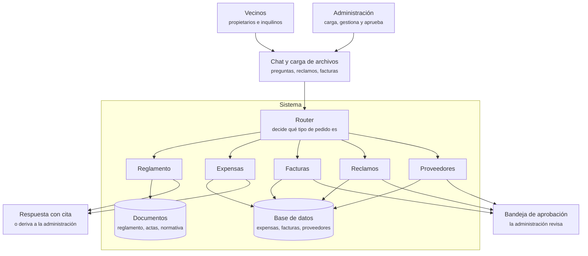

# IAA – Asistente para consorcios

TP grupal de Inteligencia Artificial Agéntica (Maestría en Data Mining, UBA) – Grupo 6.

Asistente para la administración de consorcios: responde consultas sobre reglamento y expensas citando la fuente, asiste la carga de facturas, registra reclamos y ayuda a gestionar proveedores, con revisión humana en las acciones importantes.

## Cómo funciona

- **Consultas** (reglamento, expensas): el sistema busca en los documentos o en las tablas y responde citando la fuente. Si no puede verificar la respuesta, deriva a la administración.
- **Acciones** (guardar una factura, registrar un reclamo, contactar a un proveedor): el sistema las propone y la administración las aprueba, edita o rechaza antes de que se ejecuten.

## Próximos pasos

**1. Datos**
- [ ] OCR del reglamento de copropiedad y las 4 actas (76 páginas escaneadas) y revisión a mano
- [ ] Extraer el texto de la normativa, el reglamento de cocheras y las convocatorias
- [ ] Pasar las 8 liquidaciones a una tabla (período, rubro, monto, unidad)
- [ ] Extraer los datos de las facturas y compararlos contra el listado de gastos de agosto
- [ ] Armar la tabla de unidades
- [ ] Escribir las preguntas de prueba con su respuesta correcta (separadas en desarrollo y test)

**2. Buscador sobre documentos**
- [ ] Partir los documentos en fragmentos y armar el índice
- [ ] Comparar contra una búsqueda por palabras clave usando las preguntas de prueba

**3. Respuestas con cita**
- [ ] Responder con los fragmentos encontrados, citando la fuente
- [ ] Verificar que la cita exista y derivar cuando no se puede responder

**4. Herramientas sobre las tablas**
- [ ] Consultar expensas, buscar proveedores, registrar reclamos
- [ ] Router que decide qué herramienta usar

**5. Carga de facturas y bandeja de aprobación**
- [ ] Leer una factura y extraer sus datos
- [ ] Bandeja donde la administración aprueba, edita o rechaza

**Cierre**
- [ ] Correr la evaluación sobre el set de test
- [ ] Medir costos y tiempos
- [ ] Completar el informe y armar la presentación

## Qué hay en el repo

- `docs/informe.md`: el informe del TP, organizado según lo que pide la consigna.
- `docs/bitacora.md`: notas de cómo fue el desarrollo.
- `docs/fuentes.md`: qué datos usa el sistema y de dónde salen.
- `docs/consigna.md` y `docs/propuesta/`: consigna, propuesta presentada, devolución de la cátedra, entrevista e ideas de módulos.
- `datos/`: normativa, documentos, expensas, facturas y comunicados reales del consorcio, más proveedores y preguntas de prueba.
- `src/`: el código.

## Cómo correrlo

Pendiente.

## Integrantes

Pendiente.
