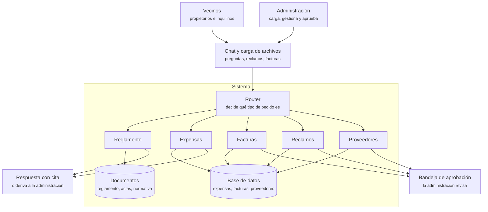

# IAA – Asistente para consorcios

TP grupal de Inteligencia Artificial Agéntica (Maestría en Data Mining, UBA) – Grupo 6.

Asistente para la administración de consorcios: responde consultas sobre reglamento y expensas citando la fuente, asiste la carga de facturas, registra reclamos y ayuda a gestionar proveedores, con revisión humana en las acciones importantes.

## Cómo funciona



- **Consultas** (reglamento, expensas): el sistema busca en los documentos o en las tablas y responde citando la fuente. Si no puede verificar la respuesta, deriva a la administración.
- **Acciones** (guardar una factura, registrar un reclamo, contactar a un proveedor): el sistema las propone y la administración las aprueba, edita o rechaza antes de que se ejecuten.

## Próximos pasos

**1. Datos**
- [x] OCR del reglamento de copropiedad y las 4 actas (76 páginas escaneadas) → `consorcio ingestar` (26/10); falta revisión a mano
- [x] Extraer el texto del reglamento de cocheras y las convocatorias (26/10); falta la normativa
- [x] Pasar las 8 liquidaciones a una tabla (período, rubro, gasto, unidad) → `consorcio expensas` (26/10)
- [ ] Extraer los datos de las facturas y compararlos contra el listado de gastos de agosto
- [ ] Armar la tabla de unidades (el prorrateo de las liquidaciones ya da UF, piso-depto y porcentual)
- [x] Escribir las preguntas de prueba con su respuesta correcta, separadas en dev y test → `datos/evaluacion/preguntas.csv` (26/10, 26 preguntas: cocheras, actas, convocatorias, liquidación, reglamento de copropiedad y 2 trampa; ampliar)

**2. Buscador sobre documentos**
- [x] Índice: las secciones que deja la ingesta en Postgres, búsqueda de texto completo en español (26/10)
- [x] Comparar contra una búsqueda por palabras clave → `consorcio evaluar-consultas` (26/10)
- [x] Canal de Telegram (`make bot`): PDF → ingesta, texto → `preguntar`, `/expensas` → SQL, lista blanca de chats
- [x] Una base por consorcio y por chat de Telegram (`consorcio_id` en documentos y consultas; `make consorcios`, `make asignar`); falta la UI de administración de consorcios
- [ ] WhatsApp: queda para después (la API de Meta pide número de negocio, verificación y webhook público; ver bitácora 26/10)
- [ ] Probar embeddings (pgvector) o pesos por título: en test el baseline de palabras clave le ganó a tsvector (0,917 vs 0,583 de recall@3; ver `docs/evaluaciones/2026-10-26-consultas-y-expensas.md` §3)

**3. Respuestas con cita**
- [x] Responder con las secciones encontradas, citando la fuente → `consorcio preguntar` (26/10)
- [x] Verificar que la cita exista textualmente y derivar cuando no se puede responder (26/10)

**4. Herramientas sobre las tablas**
- [x] Consultar expensas por SQL (26/10)
- [ ] Buscar proveedores, registrar reclamos
- [ ] Router que decide qué herramienta usar

**5. Carga de facturas y bandeja de aprobación**
- [ ] Leer una factura y extraer sus datos
- [ ] Bandeja donde la administración aprueba, edita o rechaza

**Cierre**
- [ ] Correr la evaluación sobre el set de test
- [ ] Medir costos y tiempos
- [ ] Completar el informe y armar la presentación

## Qué hay en el repo

**Para entender la prueba de concepto tal como está hoy** (diagramas del agente, qué pasa con cada petición, números medidos y límites): [`docs/poc.md`](docs/poc.md).

- `docs/informe.md`: el informe del TP, organizado según lo que pide la consigna.
- `docs/bitacora.md`: notas de cómo fue el desarrollo.
- `docs/fuentes.md`: qué datos usa el sistema y de dónde salen.
- `docs/consigna.md` y `docs/propuesta/`: consigna, propuesta presentada, devolución de la cátedra, entrevista e ideas de módulos.
- `datos/`: normativa, documentos, expensas, facturas y comunicados reales del consorcio, más proveedores y preguntas de prueba.
- `src/`: el código (ver `src/LEEME.md`).
- `skills/`: instrucciones versionadas que recibe el modelo (`ingesta`: transcribir, clasificar, estructurar, liquidación; `consulta`: responder con cita).
- `tests/`: pruebas; corren con el proveedor `fake` sin gastar tokens.
- `docs/evaluaciones/`: resultados de cada evaluación corrida (OCR, extracción), con fecha.
- `docs/practicas/`: consignas de las prácticas de la materia en las que se basa el diseño (LangGraph, HIL, MLflow).

## Cómo correrlo

Todo corre en Docker (app con Python 3.12 + Tesseract, Postgres, Neo4j y MLflow).

```bash
cp .env.example .env        # completar LLM_PROVIDER y la clave del proveedor; con "fake" corre sin clave
docker compose build
docker compose up -d
make test                   # tests sin modelo real (proveedor fake)

# Tool 1: ingestar un PDF (clasifica calidad → extrae → estructura → guarda)
make ingestar PDF="datos/documentos/REGLAMENTO COCHERAS MERCEDES_12-05-2026_18_59_13 (1).pdf"
make ingestar PDF="datos/documentos/ACTA_MERCEDES_25-7-2024.pdf" METODO=vision   # forzar método

# Procesar solo algunas páginas y elegir proveedor/modelo para esa corrida
docker compose exec app consorcio ingestar "datos/documentos/REGLAMENTO DE COPROPIEDAD_10-04-2025_16_24_47 (1).pdf"     --paginas 1-5 --proveedor anthropic --modelo claude-haiku-5-5

# Volver a estructurar sin pagar de nuevo la transcripción (reutiliza las páginas OCR/visión guardadas)
docker compose exec app consorcio ingestar "datos/documentos/REGLAMENTO DE COPROPIEDAD_10-04-2025_16_24_47 (1).pdf" --reusar-texto

# Solo ver la decisión del clasificador (no usa el modelo)
docker compose exec app consorcio clasificar "datos/documentos/ACTA_MERCEDES_25-7-2024.pdf"

# Comparar la transcripción contra una referencia hecha a mano
make evaluar-ocr PDF="datos/documentos/contrato edificio cabrera.pdf" REF="datos/documentos/contrato edificio cabrera.md"
docker compose exec app consorcio evaluar-ocr "datos/documentos/contrato edificio cabrera.pdf"     "datos/documentos/contrato edificio cabrera.md" --metodo vision --paginas 1-3 --proveedor google_genai --sin-transcripcion

# Sacar un documento del buscador sin borrarlo
docker compose exec app consorcio documentos --desactivar "ACTA_MERCEDES_25-7-2024"

# Bases por consorcio: ingestar, preguntar, expensas, evaluar-consultas y documentos aceptan --consorcio
# (por defecto CONSORCIO_POR_DEFECTO=mercedes-274). El contrato Cabrera vive en el consorcio "cabrera".
docker compose exec app consorcio preguntar "¿Qué dice sobre el fondo de reserva?" --consorcio cabrera
make consorcios

# Tool 2: preguntar con cita verificada (busca en las secciones ingestadas, 1 llamada al modelo)
make preguntar Q="¿Puedo tener dos autos en mi cochera?"
docker compose exec app consorcio preguntar "¿Qué se aprobó en la asamblea de julio de 2024?" --busqueda palabras --json

# Liquidaciones de expensas: se ingestan con el mismo comando y después se consultan por SQL, sin modelo
make ingestar PDF="datos/expensas/2026-08-09-171843-MERCEDES_274.pdf"
make expensas QUE=rubros PERIODO=2026-07
make expensas QUE=unidades PERIODO=2026-07 UNIDAD=5-D
make expensas QUE=gastos TEXTO=limpieza

# Evaluación de consultas: recall@3 del buscador (tsvector vs. palabras clave) y, con CON_MODELO=1, calidad de las respuestas
make evaluar-consultas PARTICION=dev
make evaluar-consultas PARTICION=test CON_MODELO=1

make psql      # consola de Postgres        http://localhost:7474  Neo4j (neo4j / consorcio123)
make cypher    # consola de Neo4j           http://localhost:5000  MLflow
```

### Probarlo por Telegram

El bot (`src/consorcio/canales/telegram.py`) es un cliente de las mismas tools: un PDF adjunto dispara
la ingesta, un texto va a `preguntar` y `/expensas` consulta las liquidaciones por SQL. Corre con
*long polling*, así que no necesita IP pública ni HTTPS.

```bash
# 1. Crear el bot con @BotFather y copiar el token a .env (TELEGRAM_BOT_TOKEN=...). El del grupo es @con_adm_bot;
#    el token lo tiene Joaco (no va al repo). Ojo: el .env tiene que terminar en salto de línea antes de agregar la variable.
# 2. Levantarlo (tiene su propio contenedor; `docker compose up -d` no lo arranca sin pedirlo)
make bot
make bot-logs
# 3. Abrir el chat con el bot, mandar /start: contesta la ayuda y el id del chat.
#    Poner ese id en TELEGRAM_CHATS_PERMITIDOS (vacío = responde a cualquiera, solo para probar)
#    y recrear: docker compose --profile bot up -d --force-recreate bot
```

En el chat: mandar un PDF (lo clasifica, lo ingesta y avisa; un escaneado por visión tarda minutos),
escribir una pregunta (responde con cita verificada o deriva), `/expensas rubros 2026-07`,
`/expensas 2026-07 5-D`, `/expensas gastos limpieza`, `/documentos`. Los pedidos se atienden de a uno
(Ollama gratuito admite una llamada a la vez) y las consultas quedan en `consultas` con `origen=telegram`.

**Cada número o grupo tiene su propia base.** La primera vez que un chat le habla al bot se le crea un
consorcio vacío (`chat-<id>` o `grupo-<id>`): arranca sin documentos, deriva todo, y responde solo con
lo que se le sube desde ese chat. La base de Mercedes 274 (`mercedes-274`, la que se evalúa) no se toca
desde Telegram salvo que se asigne un chat a ella. Para que varios números compartan un consorcio:

```bash
make consorcios                      # lista las bases y los chats de cada una
make consultas ORIGEN=telegram       # qué se preguntó por el chat y qué se contestó (tabla `consultas`)
make bot-logs                        # log del bot: PDFs recibidos, preguntas, llamadas al modelo
# MLflow (http://localhost:5000, experimento consorcio-ingesta): en "Model training" están los runs con métricas y
# costo; en "GenAI" las trazas de cada consulta/ingesta con los spans de LangGraph y el prompt y la respuesta del modelo
make asignar CHAT=1976380707 A=demo  # ese número pasa a usar la base "demo" (se crea si no existe)
```

En grupos, Telegram no entrega los mensajes comunes a un bot con *privacy mode* (el default de BotFather):
desactivarlo con `/setprivacy`, o usar `/preguntar ...` y mandar el PDF como respuesta al bot.

Guion de la demo en vivo (chat nuevo = base vacía): preguntar algo (deriva) → subir el reglamento de
cocheras (1 minuto, tiene capa de texto) → repetir la pregunta (responde con cita) → subir una liquidación
→ `/expensas rubros`. Evitar escaneados grandes con la cuota gratuita de Ollama (el reglamento de
copropiedad por visión tarda horas).

### Si recibís el proyecto

Para probarlo sin reingestar nada (la ingesta completa con la cuota gratuita de Ollama lleva horas):

```bash
cp .env.example .env            # con LLM_PROVIDER=fake corre sin clave
docker compose build && docker compose up -d
make restaurar                  # carga datos/respaldo/postgres-<fecha>.sql: 17 documentos, 8 liquidaciones, ya migrado a consorcios
make test && make lint          # 25 tests, proveedor fake
make expensas QUE=rubros PERIODO=2026-07
make evaluar-consultas PARTICION=dev      # recall@3 del buscador, sin modelo
```

Para que el modelo responda de verdad hace falta una clave: la gratuita de Ollama (ollama.com, un pedido a
la vez) alcanza para `preguntar`, `make evaluar-consultas CON_MODELO=1` y el bot. Poner en `.env`
`LLM_PROVIDER=ollama`, `LLM_MODEL=gpt-oss:120b`, `LLM_MODEL_VISION=gemma4:31b`, `OLLAMA_API_KEY=...` y
recrear el contenedor (`docker compose up -d --force-recreate app`). Para probar la ingesta, empezar por un
PDF chico con capa de texto (el reglamento de cocheras, 2 páginas). `make respaldar` genera un volcado nuevo.

Sin `make` (Windows sin Git Bash): reemplazar `make X` por el comando equivalente del `Makefile`, p. ej.
`docker compose exec app consorcio ingestar "ruta.pdf" --metodo auto`.

Qué deja cada ingesta:
- `datos/procesados/<archivo>-<hash>/texto.md`: transcripción página por página con el método usado.
- `datos/procesados/<archivo>-<hash>/extraccion.json`: metadatos, entidades, clasificación, llamadas y costo.
- Postgres: tablas `documentos`, `paginas`, `personas`, `organizaciones`, `direcciones`, `eventos`, `unidades`, `montos`, `secciones`, `datos_sensibles` (con marca `sensible`), `llamadas_modelo`; para liquidaciones, además `liquidaciones`, `liquidacion_rubros`, `liquidacion_gastos`, `liquidacion_unidades`.
- Neo4j: grafo `Documento → Persona / Organizacion / Direccion / Evento / Unidad / Seccion → Tema` (sin datos sensibles).

Qué deja cada consulta (`preguntar`): una fila en `consultas` (pregunta, respuesta, cita, si se verificó, si se derivó, tokens, costo, segundos) y un run `consulta` en MLflow.

## Integrantes

Pendiente.
