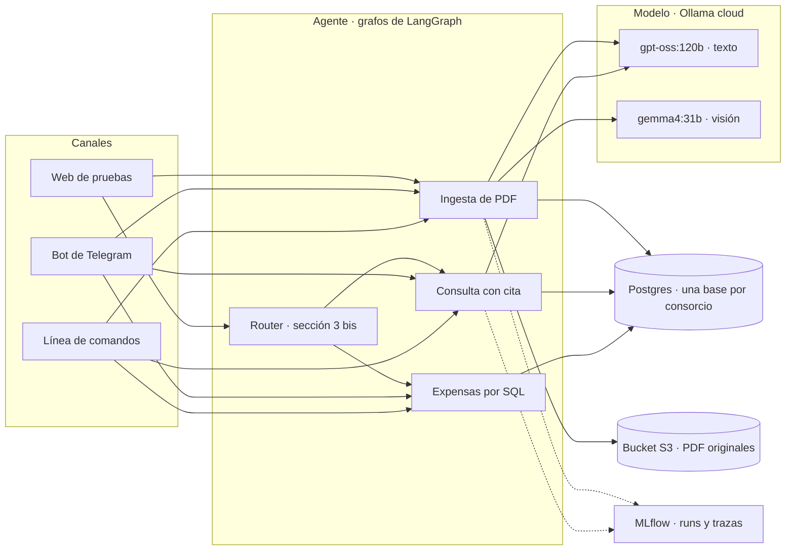
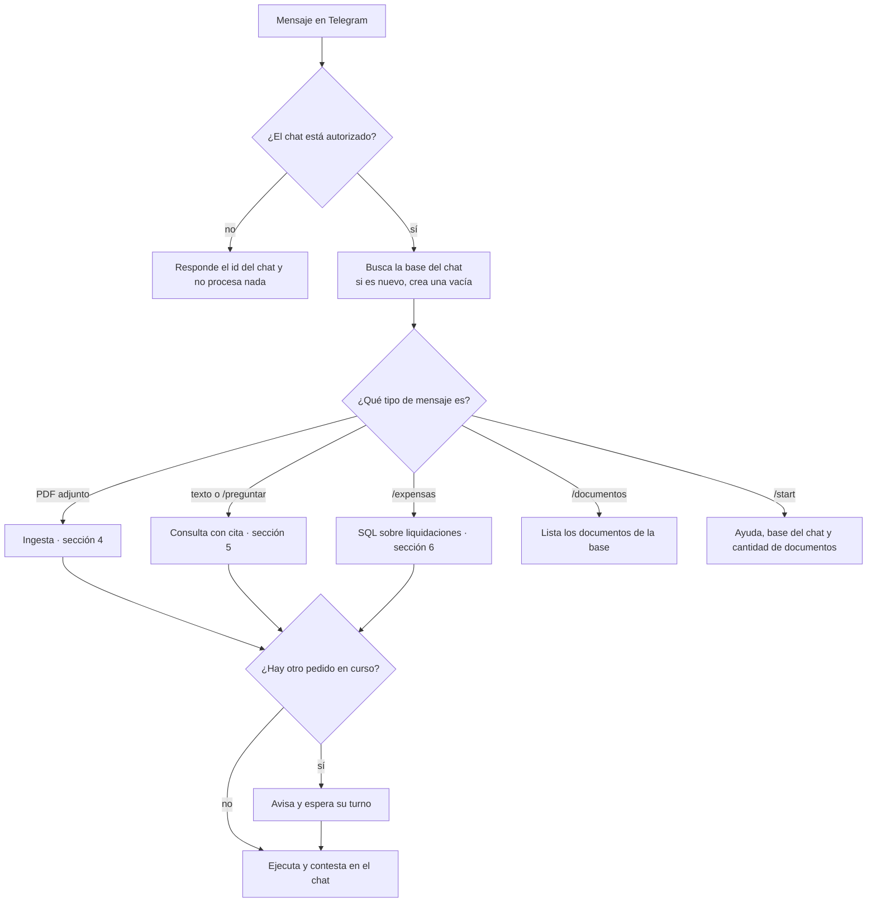
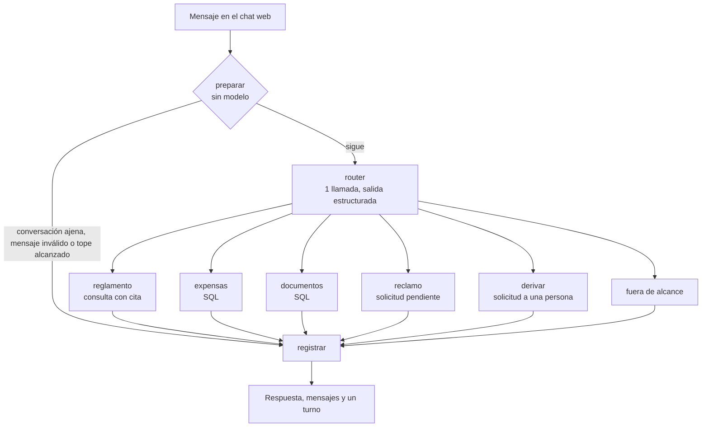
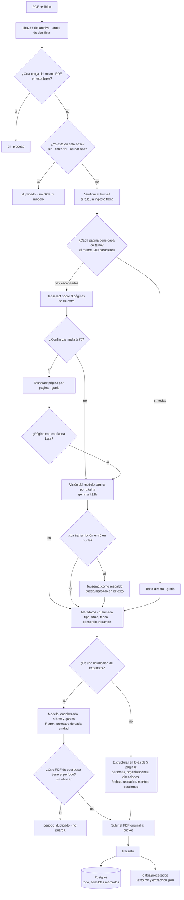
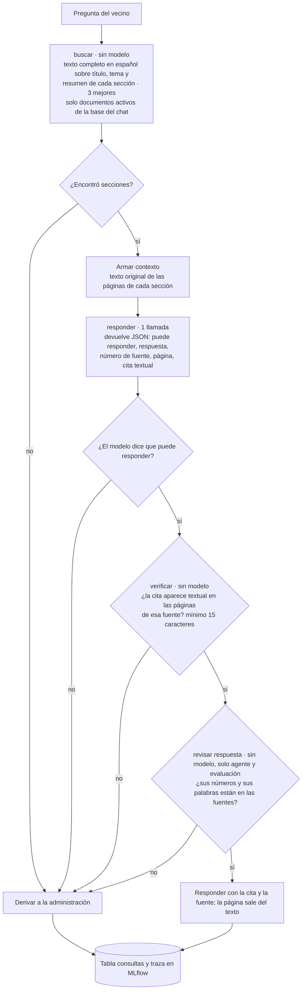

# Prueba de concepto: cómo funciona el agente

Estado al 01/11/2026. Este documento describe lo que el agente **hace hoy**, paso a paso, con los
números medidos. Lo que todavía no existe está al final, en "Qué no hace todavía". El diseño completo
previsto está en el README y en `docs/informe.md` §5; las decisiones y los tropiezos, en `docs/bitacora.md`.

## 1. Qué es

Un asistente para la administración de un consorcio al que se le habla por la web de pruebas, por
Telegram o por línea de comandos. El agente con router, los reclamos y la bandeja corren solo en la web:
ver la sección 3 bis. Telegram quedó congelado hasta terminarla. El núcleo hace tres cosas:

1. **Carga documentos.** Recibe un PDF (reglamento, acta, convocatoria, liquidación de expensas), decide
   cómo leerlo, lo transcribe, extrae su estructura y lo guarda.
2. **Responde consultas citando.** Busca en lo cargado, responde con una cita textual del documento y
   comprueba por código que la cita exista. Si no puede, deriva a la administración.
3. **Consulta expensas.** Los importes de las liquidaciones se leen por SQL; el modelo nunca los genera.

Cada consorcio tiene su propia base, y cada chat de Telegram usa la suya: un chat nuevo arranca vacío
y responde solo con lo que se le sube.

## 2. Vista general

| Pieza | Dónde está | Qué decide |
|---|---|---|
| Bot de Telegram | `src/consorcio/canales/telegram.py` | Qué herramienta usar según el tipo de mensaje y qué base usa el chat |
| Ingesta | `src/consorcio/ingesta/` | Cómo leer cada página y qué extraer |
| Consulta | `src/consorcio/consulta/` | Qué secciones buscar, si se responde o se deriva |
| Expensas | `consultar_expensas` en `src/consorcio/almacen/postgres.py` | Nada: es SQL directo |
| Crudos | `src/consorcio/almacen/crudos.py` | Nada: guarda el PDF original en SeaweedFS con API S3 |
| Identidad | `src/consorcio/identidad.py` | Qué rol y qué unidades tiene un usuario en un consorcio |
| Agente | `src/consorcio/agente/` | Qué flujo atiende un mensaje de la web y qué queda para aprobación humana |
| Web y CRM | `src/consorcio/web/`, `src/consorcio/crm.py` | Quién entra a cada pantalla |
| Tope de gasto | `src/consorcio/tope.py` | Si el chat web y la ingesta pueden llamar al modelo |
| Instrucciones del modelo | `skills/ingesta/SKILL.md`, `skills/consulta/SKILL.md`, `skills/agente/SKILL.md` | Los prompts, versionados, fuera del código |

## 3. Qué pasa cuando llega una petición

El bot no usa el modelo para decidir qué hacer: lo decide el **tipo de mensaje**. La web sí usa el
router con modelo (sección 3 bis); el bot está congelado y no pasa por él.

- **Autorización.** `TELEGRAM_CHATS_PERMITIDOS` lista los chats que pueden usarlo; vacío significa
  cualquiera, solo para probar. La base tiene datos personales.
- **Una base por chat.** El primer mensaje de un número crea el consorcio `chat-<id>` (o `grupo-<id>`).
  Varios números pueden compartir un consorcio: `make asignar CHAT=<id> A=<consorcio>`.
- **De a un pedido.** El plan gratuito de Ollama acepta una llamada a la vez, así que el bot atiende en
  fila. La ingesta corre en un hilo aparte para que el bot siga recibiendo mensajes.
- **Sin pisar archivos.** Un PDF recibido queda en `datos/entrada/<file_unique_id>/`: dos archivos con el
  mismo nombre no se pisan.

**Usuarios y aislamiento.** La capa de datos y las tools exigen `consorcio_id` y fallan si falta; solo la
línea de comandos y la evaluación resuelven `CONSORCIO_POR_DEFECTO`. Las tablas `usuarios`, `membresias` y
`membresia_unidades` dicen qué rol y qué unidades tiene cada persona en cada consorcio, y
`resolver_identidad(sujeto_externo, consorcio_id)` falla si no hay membresía, con el mismo mensaje en todos
los casos. Esto queda listo para el login, que lo hace otra persona y solo entrega `sujeto_externo`.

## 3 bis. Un mensaje en la web

- **El alcance sale de la identidad.** La salida del router no tiene campos de consorcio, usuario ni rol:
  rol y membresía se resuelven en cada pedido, y dentro de un consorcio cualquier miembro ve las expensas
  de todas las unidades, como en la liquidación.
- **Los importes salen de SQL.** El router elige qué consultar; el texto de expensas lo arma el código.
- **Toda acción espera a una persona.** Un reclamo solo crea una solicitud `pendiente`. El administrador
  del consorcio aprueba, edita o rechaza en `/bandeja`, y el autor ve la respuesta en `/mis-solicitudes`.
- **Si algo falla, deriva.** Un router inválido, una cita sin verificar, una respuesta sin respaldo o un error
  de una funcionalidad crean una solicitud para una persona; `atender` no propaga excepciones.
- **Un mensaje, un turno.** `turnos` guarda solo métricas, sin texto; el texto va a `mensajes`. `/crm`, solo
  para el equipo de plataforma, lee `turnos` y no `mensajes`.
- **Tope.** Con el tope mensual alcanzado, ni el chat ni la ingesta llaman al modelo. Es una barrera de la
  aplicación: el tope del proveedor hay que configurarlo aparte.

## 4. Ingesta de un PDF

| Paso | Usa modelo | Qué produce | Por qué así |
|---|---|---|---|
| Hash y duplicados | No | `duplicado` o `en_proceso` | Un PDF repetido se corta antes de gastar OCR o modelo |
| Clasificar | No | Método por página y su motivo | Solo se pagan tokens de visión donde Tesseract no alcanza |
| Extraer texto | Solo visión | Texto de cada página | La capa de texto y Tesseract son gratis |
| Freno a bucles | No | Tesseract si la visión devuelve basura repetida | Una página devolvió 261 mil tokens en bucle; Ollama ignora el tope de salida |
| Metadatos | 1 llamada | Tipo y resumen del documento | Decide si es liquidación |
| Estructurar | 1 llamada cada 5 páginas | Entidades y secciones con página de origen | Las secciones son lo que después busca la consulta |
| Liquidación | 1 llamada + regex | Rubros, gastos y unas 140 filas de prorrateo | El modelo no copia 140 filas de importes; la regex sí, y cuenta las que no matchean |
| Preparar guardado | No | `periodo_duplicado`, o el PDF original en el bucket | El período recién se conoce al extraer la liquidación |
| Persistir | No | Postgres y archivos revisables | Los datos sensibles no salen de Postgres |

El documento se identifica por consorcio y hash, y cada ingesta termina en un `estado`:

| Estado | Cuándo | Qué guarda |
|---|---|---|
| `procesado` | Ingesta completa | Postgres, bucket y archivos |
| `solo_disco` | `--sin-persistir` o `--paginas` | Solo archivos: una corrida parcial nunca pisa ni registra el documento |
| `duplicado` | El mismo PDF ya está en esta base | Nada; nombra el documento existente |
| `en_proceso` | Otra carga del mismo PDF en esta base (advisory lock de Postgres) | Nada |
| `periodo_duplicado` | Otro PDF de esta base tiene la liquidación de ese período | Solo archivos |

`--forzar` reprocesa y reemplaza: queda una sola liquidación por período y se borra el crudo anterior.
`--reusar-texto` reaprovecha las páginas ya transcriptas para volver a estructurar sin pagar la visión
otra vez; reprocesa, pero no reemplaza otro PDF. El mismo PDF en dos bases son dos documentos
independientes, y ningún aviso revela que exista en otra. Sin `S3_ENDPOINT_URL` la ingesta sigue solo en
local, con un warning.

## 5. Consulta con cita

Tres caminos llevan a derivar, y los tres quedan registrados con su motivo:

1. La búsqueda no encontró ninguna sección relacionada.
2. El modelo leyó las fuentes y dijo que no alcanzan.
3. El modelo respondió, pero su cita no está en el texto original. Se compara contra las páginas, no
   contra el resumen que escribió el modelo al ingestar.

**Ejemplo real** (traza de MLflow del 26/10, base de Mercedes 274):

| Paso | Tiempo | Qué pasó |
|---|---|---|
| buscar | 0,18 s | Recuperó 3 secciones; la 3.ª era el Artículo 3 del reglamento de cocheras |
| responder | 2,08 s | 1 llamada a gpt-oss:120b, 3.425 tokens. Devolvió: puede responder, "como máximo dos vehículos", fuente 3, página 5, cita "Dentro de su espacio se permiten hasta 2 vehículos." |
| verificar | 1 ms | La cita está en la página: respondió con cita y fuente |

Pregunta: "¿Cuántos vehículos puedo tener en la cochera?". La misma pregunta en un chat sin documentos
se deriva por el camino 1.

## 6. Expensas

`/expensas` (o `consorcio expensas`) consulta las tablas que llenó la ingesta de liquidaciones:
resumen por período, rubros, gastos filtrados por texto, y lo que paga cada unidad. No hay modelo en
este camino. Ejemplos: `/expensas rubros 2026-07`, `/expensas 2026-07 5-D`, `/expensas gastos limpieza`.

Dentro de un consorcio, los propietarios ven las expensas por unidad como en la liquidación, así que
no hay filtro por rol. Nada cruza entre consorcios.

Si un vecino pregunta por expensas en lenguaje natural, hoy va al camino de consulta con cita, que
sirve para "qué dice la liquidación" pero no para comparar importes (ver sección 9).

## 7. Modelo y proveedor

| | Hoy | Por qué |
|---|---|---|
| Proveedor | Ollama cloud, plan gratuito (`https://ollama.com/v1`) | La clave de Anthropic venció; AI Studio gratuito da 20 pedidos por día |
| Texto | `gpt-oss:120b` | Modelo de pesos abiertos publicado por OpenAI; no es GPT-4 ni GPT-5 |
| Visión | `gemma4:31b` | Solo para páginas escaneadas que Tesseract no lee bien |
| Cliente | `ChatOpenAI` de LangChain | Ollama expone la API compatible con OpenAI; por eso la traza muestra ese nombre |

El proveedor se cambia en `.env` (`LLM_PROVIDER`, `LLM_MODEL`) sin tocar código. Cada run y cada traza
de MLflow llevan las etiquetas `proveedor`, `modelo` y `endpoint`. Con una clave paga, el candidato es
Claude Haiku 5.5: fue el de mejor relación calidad/costo en `docs/evaluaciones/`.

## 8. Qué queda registrado

| Dónde | Qué | Cómo verlo |
|---|---|---|
| Tabla `consultas` | Cada pregunta: canal, base, respuesta, cita, si se verificó o derivó, motivo, tokens, segundos | `make consultas ORIGEN=telegram` |
| Tabla `documentos` | `sha256` del archivo y `crudo_clave`, la clave del PDF en el bucket | `make psql` |
| Bucket S3 | El PDF original, con clave `<consorcio>/<sha256>.pdf` | SeaweedFS, puerto 8333 en la máquina local |
| Tabla `llamadas_modelo` | Cada llamada de una ingesta: nodo, modelo, tokens, segundos, costo | `make psql` |
| MLflow, vista Model training | Un run por consulta o ingesta con métricas y costo | http://localhost:5000, experimento consorcio-ingesta |
| MLflow, vista GenAI | Una traza por petición con los pasos del grafo y el prompt y la respuesta del modelo | Pestaña Traces del mismo experimento |
| Tablas `turnos` y `solicitudes` | Cada mensaje de la web, sin texto, y lo que quedó para una persona | `/crm`, `/bandeja` |
| Tabla `gastos_modelo` | Libro solo-inserción con el gasto real en modelos de cualquier canal | `make gasto` |
| Log del bot | PDFs recibidos, preguntas, resultado | `make bot-logs` |
| `datos/procesados/` | Transcripción y extracción de cada documento | Archivos `texto.md` y `extraccion.json` |

## 9. Resultados medidos

Detalle en `docs/evaluaciones/2026-10-26-consultas-y-expensas.md`. Set de 26 preguntas sobre Mercedes 274,
partido en desarrollo y prueba, con 2 preguntas trampa que deben derivarse.

| | Desarrollo | Prueba |
|---|---|---|
| Búsqueda: la sección correcta entre las 3 primeras, sistema | 1,000 | 0,583 |
| Búsqueda: lo mismo con palabras clave, línea de base | 0,917 | 0,917 |
| Respuestas correctas | 12 de 13 | 8 de 13 |
| Citas inventadas | 0 | 0 |
| Preguntas trampa derivadas | 1 de 1 | 1 de 1 |

| Costo y tiempo | Valor |
|---|---|
| Tokens por consulta, promedio | 3.416 de entrada y 430 de salida |
| Segundos por consulta | 2 |
| USD por consulta con Haiku 5.5, estimado | 0,0006 |
| Ingesta con capa de texto, 2 páginas | menos de 1 minuto |
| Ingesta escaneo legible, 42 páginas, por Tesseract | 3 minutos, 10 llamadas |
| Ingesta escaneo difícil, 60 páginas, por visión con Ollama gratuito | casi 1 hora, 73 llamadas |

Lectura: el agente no inventa citas y deriva cuando debe. Sus fallas son de búsqueda: en la partición
de prueba la línea de base por palabras clave encontró más que el sistema, y eso queda como hipótesis
abierta para la próxima iteración, que se decide mirando solo la partición de desarrollo.

## 10. Qué no hace todavía

- **Login.** La web usa `resolver_identidad`, pero con un selector de usuarios demo: el login real falta.
  `consultas.usuario_id` queda vacío en la línea de comandos y en Telegram.
- **Router con modelo en Telegram.** En Telegram y la CLI el camino lo sigue eligiendo el tipo de mensaje.
  Una pregunta sobre expensas en lenguaje natural va al buscador y no a SQL; "¿cuál fue el rubro de mayor
  gasto?" se respondió mal con una cita verídica. El router de la web tampoco se evaluó con un modelo real.
- **Revisión de documentos.** La bandeja atiende derivaciones y reclamos; los documentos quedan en estado
  `extraido` sin revisar.
- **Facturas, proveedores, calendario y email.** No existen.
- **WhatsApp.** Pide número de negocio verificado y un servidor público; se dejó para después.
- **Vigencia.** Un acta que modifica el reglamento no anula el artículo viejo: los dos se pueden recuperar.
- **Cuota gratuita.** Una llamada a la vez; un escaneo grande por visión tarda horas.
- **Muestra sanitizada.** Los datos son reales y el repo hoy está público: hay que sanitizarlo, y falta la
  versión anonimizada que pide la consigna.

## 11. Cómo probarlo

Con la base ya cargada, desde el repo: `make restaurar`, `make db-actualizar`,
`make test`, `make preguntar Q="..."`. Por
Telegram: `make bot`, escribirle a `@con_adm_bot`, seguir el guion del README ("Probarlo por Telegram":
preguntar, ver que deriva, subir el reglamento de cocheras, volver a preguntar). Por la web, sin clave:
`make sembrar-demo`, `make web` y el guion del README ("Probarlo por la web"). Los grafos se pueden
redibujar desde el código con `consorcio dibujar-grafo ingesta`, `consulta` o `agente`.
